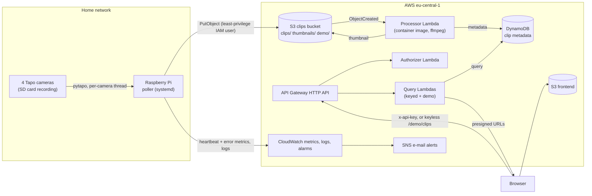

# Tapo Camera Backend

A small production system for home security footage. A Raspberry Pi collects motion clips from four Tapo cameras and uploads them to AWS. A serverless pipeline generates thumbnails and metadata, and an authenticated web page serves the clips. Without an access code, the same page opens a public demo of curated clips.

The point is how it is built and run, not the features: everything in AWS is Terraform, CI/CD authenticates with OIDC (no stored AWS keys), each component has least-privilege IAM, and every failure mode I've hit is either alarmed on or documented. Decisions, incidents and their reasoning are kept in [docs/project-notes.md](docs/project-notes.md).

## Architecture



1. **Poller** ([poller/poller.py](poller/poller.py)): one thread and one long-lived event loop per camera, with per-camera polling intervals and a slower night mode. The battery-powered camera's drain depends on session length, so its backlog is kept small. Progress is persisted after every uploaded clip, so a restart resumes mid-cycle. It emits `PollCycleCompleted` / `PollCycleErrors` per camera; metrics and log shipping are best-effort and never block uploads.
2. **Processor** ([terraform/lambda/processor/](terraform/lambda/processor/)): triggered by S3, it extracts a thumbnail with ffmpeg and writes metadata to DynamoDB. It ships as a container image with a minimal ffmpeg built from source (see Supply chain).
3. **Query API** ([terraform/lambda/query/](terraform/lambda/query/), [terraform/lambda/authorizer/](terraform/lambda/authorizer/)): `GET /clips?date=YYYYMMDD[&camera=...]` returns metadata with short-lived presigned URLs. A Lambda authorizer checks a shared secret. `GET /demo/clips` needs no key: it runs the same code as a second function scoped to the `demo` camera, and is throttled.
4. **Frontend** ([frontend/index.html](frontend/index.html)): a static page that reads the API endpoint from a `config.json` generated at deploy time. With no stored access code it opens in demo mode.

## Security controls

| Control | Threat it mitigates | Implemented in | Verified by |
|---|---|---|---|
| No long-lived CI credentials: GitHub OIDC with separate plan and apply roles, scoped to this repo's `main` branch / PRs | Leaked CI secrets give persistent AWS access | [terraform/bootstrap/](terraform/bootstrap/) (applied locally, never from CI) | CI has no AWS secrets; PR plans run under a `ReadOnlyAccess` role |
| Least-privilege IAM per Lambda (inline, 1:1 policies) and for the Pi (`s3:PutObject` + metrics/logs only) | A compromised component reaches other resources | [processor.tf](terraform/processor.tf), [api.tf](terraform/api.tf), [poller.tf](terraform/poller.tf) | `terraform plan` in PR review |
| API authentication: Lambda authorizer, constant-time compare, fails closed if SSM is unreachable | Unauthenticated access to footage | [authorizer/handler.py](terraform/lambda/authorizer/handler.py) | [tests/test_authorizer.py](tests/test_authorizer.py) |
| Secrets out of code and logs: API secret generated by Terraform, stored as SSM SecureString; the query Lambda logs only query parameters | Secret disclosure via repo or logs | [api.tf](terraform/api.tf), [query/handler.py](terraform/lambda/query/handler.py) | Test asserts the key never reaches the logs ([tests/test_query.py](tests/test_query.py)) |
| Clips bucket private, encrypted; access only via presigned URLs (1 h) | Public exposure of footage | [clips.tf](terraform/clips.tf), [query/handler.py](terraform/lambda/query/handler.py) | Public access block in plan; tests |
| CORS restricted to the frontend's origins | Other sites calling the API from a victim's browser | [api.tf](terraform/api.tf) | Plan review |
| Data retention: 60 days for clips, thumbnails and metadata; deleted versions kept 7 days. Only the curated demo clips, under their own `demo/` root, are kept until deleted by hand | Keeping personal data longer than needed (GDPR) | [clips.tf](terraform/clips.tf), processor `ttl` | Lifecycle rules in plan; [tests/test_processor.py](tests/test_processor.py) (demo rows get no `ttl`) |
| Public demo scoped in code and in IAM: the demo function can only query `camera_id = demo` (`dynamodb:LeadingKeys`) and read `demo/` objects; the route is throttled. The poller can't write under `demo/`, and the processor rejects real cameras there | A keyless route exposing real footage | [api.tf](terraform/api.tf), [query/handler.py](terraform/lambda/query/handler.py), [processor/handler.py](terraform/lambda/processor/handler.py) | [tests/test_query.py](tests/test_query.py) (the demo never returns another camera); plan review |
| Supply chain: digest-pinned base image, ffmpeg from a GPG-verified, SHA-256-pinned tarball, Dependabot for base digest and pins, ECR scan on push, immutable tags | Vulnerable or tampered dependencies | [Dockerfile](terraform/lambda/processor/Dockerfile), [deploy.yml](.github/workflows/deploy.yml) | Image smoke test in CI; scan report on every deploy |
| ECR repository policy: only the processor function can pull | Image exfiltration / use by other principals | [processor.tf](terraform/processor.tf) | Plan review |
| Camera override role trusted only for the `camera-control` GitHub environment, and limited to writing `/tapo/poller/override/*` | A remote toggle becoming a path to deploy credentials, or the reverse | [bootstrap/github_oidc.tf](terraform/bootstrap/github_oidc.tf), [camera-override.yml](.github/workflows/camera-override.yml) | A job in the environment has an environment OIDC subject, which the apply role doesn't trust |
| Dependabot PRs get no AWS credentials | Bot-authored code running with cloud access | [ci.yml](.github/workflows/ci.yml) | Plan job skipped for `dependabot[bot]` |

Accepted and documented: the Pi uses a long-lived, least-privilege IAM user (IAM Roles Anywhere was evaluated and judged not worth it for one device), and the shared-secret API auth is a deliberate step short of Cognito. The reasoning, and the upgrade path, are in [the notes](docs/project-notes.md#decisions-and-why).

## CI/CD

| Workflow | Trigger | What it does |
|---|---|---|
| [ci.yml](.github/workflows/ci.yml) | PRs and pushes to `main` | Lint; pytest + moto tests for all three Lambdas (a required gate; known bugs get strict `xfail` tests, never `continue-on-error`); build and smoke-test the processor image; `terraform plan` posted as a PR comment |
| [deploy.yml](.github/workflows/deploy.yml) | Merge to `main` | Build, smoke-test and push the image to ECR; `terraform apply` pinned to that image digest; deploy the frontend; report image scan findings |
| [camera-override.yml](.github/workflows/camera-override.yml) | Manual (Actions tab or GitHub mobile app) | Pause a camera, or poll it even while auto-paused, until a chosen time; writes an SSM parameter the poller reads before each cycle. Its own role, trusted only for the `camera-control` environment |

Lambda code is never deployed by hand: the zips are built by Terraform (`archive_file`, byte-identical locally and in CI), and the processor function always points at a digest-pinned image.

## Observability

- **Heartbeat per camera:** `PollCycleCompleted` comes from the poller itself, because "no clips" alone can't tell a broken poller from a quiet night. Alarmed per camera; missing data counts as breaching. A cycle skipped on purpose (manual pause or low-battery auto-pause) sends `PollCyclePaused`, which the alarm counts as alive, so a pause doesn't page but a dead thread does.
- **Errors per camera:** `PollCycleErrors`, alarmed per camera.
- **Battery:** the solar/battery camera reports `BatteryPercent` every poll, read in the session the poller already opens; alarm below 25%. Below 35% the poller stops downloading from it and checks the battery every few hours until it's back above 55%.
- **Pipeline:** `ClipsProcessed` (log metric filter, missing data treated as breaching) and processor Lambda errors.
- All alarms go to SNS e-mail. All poller and Lambda logs are in CloudWatch Logs.

## Supply chain: the ffmpeg image

The processor originally used a public ffmpeg Lambda layer from 2019: unpatched, unknown provenance, and deletable by its owner. Its replacement went through two steps:

1. Debian's ffmpeg in a container image: 875 MB, and the first scan found 1 critical and 15 high findings, all in libraries ffmpeg pulled in but this workload never uses.
2. A minimal static build: `--disable-everything` plus only the mov demuxer, H.264/HEVC decoders, MJPEG encoder and scaling. 7.5 MB, LGPL-only, linking only libc/libm. The scan went down to 1 high (zlib in the base image).

Tradeoff: ECR scanning can't see a source-built binary, so ffmpeg security releases are tracked by hand. Details: [project notes, step 4](docs/project-notes.md).

## Privacy

The cameras record a private property, and one of them partly covers a public lane where the household car is parked. Handling: signage, and the 60-day retention above, justified by real cases where older footage was needed. No real footage is in this repository; test fixtures are synthetic clips. The public demo shows a few hand-picked clips from the back camera, not the one covering the lane, with the audio (voices) and the container metadata removed.

## Repository layout

```
poller/                  Raspberry Pi poller (config.yaml is gitignored; see config.yaml.example)
terraform/               main stack, one file per component
terraform/modules/lambda generic Lambda module (zip or digest-pinned image)
terraform/bootstrap/     GitHub OIDC provider and CI roles (separate state, applied locally)
terraform/lambda/        processor (Dockerfile, smoke test), query, authorizer
tests/                   pytest + moto tests for the Lambda handlers
frontend/                static web page
scripts/                 backfill_processor.py (re-run processing for unfinished clips)
docs/project-notes.md    decisions, incident log, backlog
```

## Running the checks locally

```bash
pip install -r requirements-dev.txt
python -m pytest
terraform -chdir=terraform init && terraform -chdir=terraform plan   # needs AWS credentials and alert_email
docker build -t tapo-clip-processor:local terraform/lambda/processor   # compiles ffmpeg; takes a while
terraform/lambda/processor/smoke-test.sh tapo-clip-processor:local    # thumbnails the synthetic fixtures
```

## Roadmap

- Shared CI security gates: secret scanning, SAST, dependency audit, IaC scanning, SBOM
- SLOs and error budgets for poll success and clip freshness, with burn-rate alerts
- An incident-response agent triggered by those burn-rate alerts
